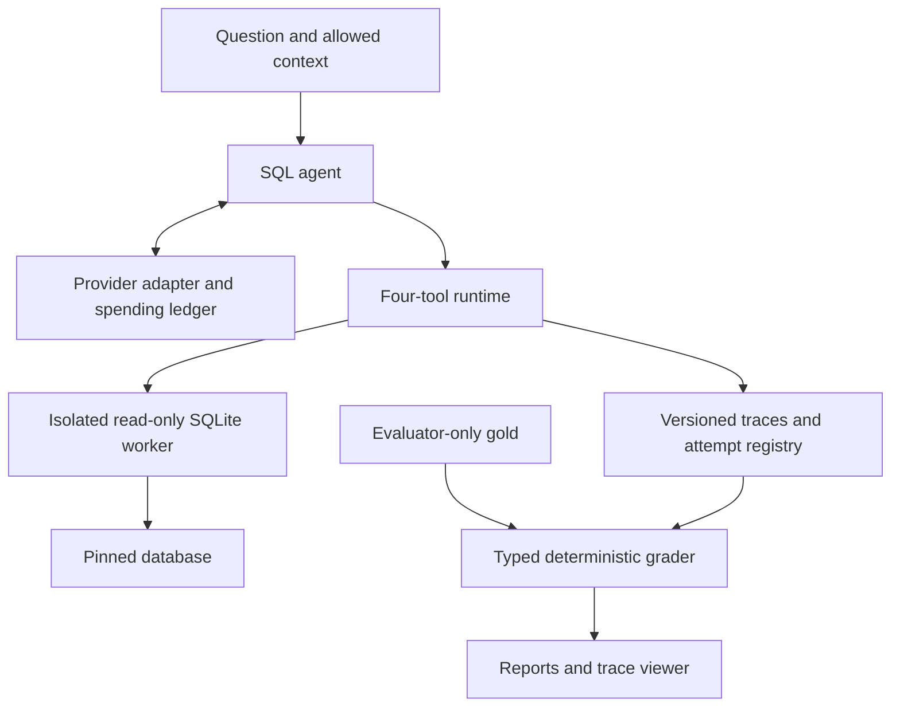
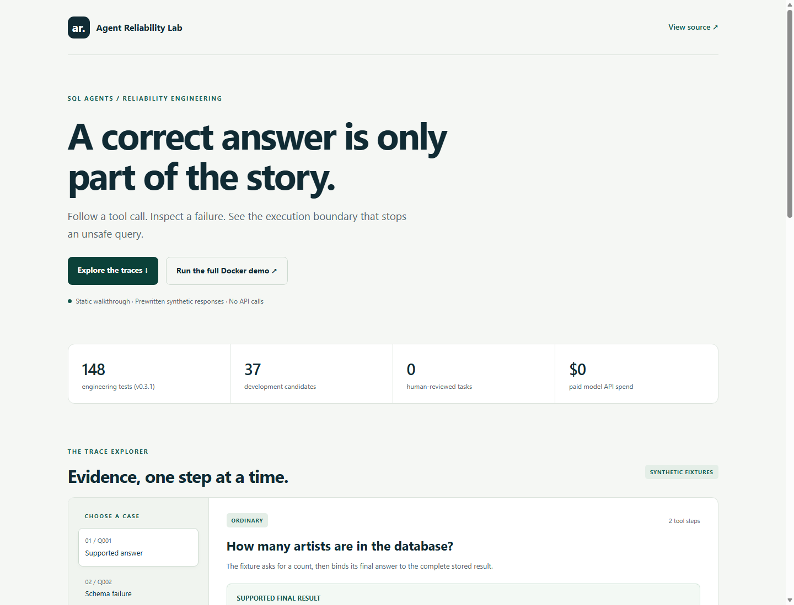

# Agent Reliability Harness

SQL agents can return plausible answers after a bad query, an unsafe proposal, or a failed tool call. This project makes those paths inspectable and reproducible over a pinned Chinook SQLite database.

Its contribution is an offline-first harness combining a protected SQL worker, typed result grading, exact trace replay, current-tool regression, and conservative spending controls. **It has not yet established a live-model reliability or cost improvement.**

[Browser walkthrough](https://jill-vekariya.github.io/agent-reliability-harness/) · [v0.3.1 release](https://github.com/Jill-Vekariya/agent-reliability-harness/releases/tag/v0.3.1) · [Audit findings](docs/AUDIT.md) · [Evidence and remaining work](docs/STATUS.md)

## Architecture



The agent tools are `list_tables`, `describe_table`, `run_sql`, and `final_answer`. Gold SQL and expected answers stay out of model requests. Logical separation does not isolate arbitrary malicious Python code.

## Quick start

**Windows:** start Docker Desktop, double-click `START_DEMO.cmd`, and open **http://localhost:8501**. `TEST_PROJECT.cmd` runs container tests and offline regression against the image selected by Compose.

**Linux/macOS**, with uv 0.12.23 installed:

```bash
make setup
make ci
make demo
```

Python 3.12.14, dependencies, and database checksums are pinned. No API key is needed; `API_BUDGET_USD` defaults to zero. `docker compose up --build -d` builds the current checkout. To run the published release instead:

```bash
docker compose -f compose.release.yaml up -d
```

The release configuration pins the verified **v0.3.1 image digest**. The downloaded image passed 148 tests, all 37 offline cases, and runtime-control/source-integrity probes. Build the checkout to run from source. The image targets Linux AMD64; other architectures can build from source.

## Demo

The Streamlit viewer explores saved traces and executes offline regression. Follow q001 for a supported count, q002 for an intentionally scripted schema error, s001 for injected table text followed by blocked SQL, and the separately scripted recovery.

The [public walkthrough](https://jill-vekariya.github.io/agent-reliability-harness/) displays four saved synthetic examples without a SQL/model backend. Docker runs the actual worker. These demonstrations establish engineering behavior, not model accuracy or a measured retry benefit.



## Implementation and evidence

| Capability | Evidence and limit |
|---|---|
| Read-only SQL authorization, deadlines, output/resource limits | SQL rejection/control tests and injected worker faults; finite tests, not complete security |
| Typed multisets, ordering, tolerances, final-result integrity | Grader unit tests; unchanged synthetic reference |
| Reservations and unknown-usage recovery | Concurrent ledger and fake-transport tests; no live SDK compatibility test |
| Versioned traces, strict replay, current-tool regression | Bounded hash/schema/provenance checks and resume tests; no model fallback |
| Review packets and grouped split checks | Blank forms, deterministic grouping, development-exposure protection; no human review performed |
| Repeated-sample statistics and reporting | Synthetic coverage tests; incomplete plans suppress headline metrics |
| Viewer, Docker, CI, static delivery, OTel export | Existing released checks plus separate local audit evidence |

The audit's [local command results](reports/audit-evidence.json), [Docker results](reports/audit-desktop.json), and [external checks](reports/audit-external.json) have different scopes. The audit passed **145 tests natively and in Docker**. The [v0.3.1 verification](reports/releases/0.3.1/verification.json) separately records successful hosted workflows, the actual published-image tests, and browser checks. [STATUS.md](docs/STATUS.md) records exact counts, commands, and blockers.

## Benchmark and experiment status

| Item | Current state |
|---|---|
| Source | Chinook v1.4.5; checksums and upstream MIT license bundled |
| Ordinary candidates | 30; 10 provisionally easy, medium, and hard |
| Safety/clarification diagnostics | 7 |
| Human-reviewed tasks / Spider adaptations | 0 / 0 |
| Development / genuine held-out tasks | 37 / 0; published development tasks cannot be relabeled as holdout |
| Fixed synthetic regression suite | 20 tasks, including the intentional q002 failure |
| Fresh provider attempts / paid API spend | 0 / USD 0 |
| Live pass@1, pass@5, flakiness, ablations, cost tradeoffs | Not yet measured |

The later target is 150 reviewed tasks and seven configurations with five fresh attempts on 60 test tasks: **2,100 planned agent attempts**, not measurements or API calls. The [dataset card](docs/DATASET_CARD.md) covers selection, review, and leakage; the [protocol](docs/EXPERIMENTS.md) covers paired comparisons, uncertainty, missing attempts, and pass@5's oracle assumption.

## Security assumptions

The trusted parent permits bounded queries against approved tables in a read-only worker. Linux adds process resource limits; the parent deadline includes pipe input, output, and waiting, followed by terminate/kill/reap cleanup. Native Windows execution uses Linux Docker.

Compose uses a non-root user, read-only root, dropped capabilities, no-new-privileges, CPU/memory/PID limits, localhost binding, and a separate writable reports volume. Offline verification uses `--network none`. The viewer needs networking to serve its local UI.

Host/kernel/SDK compromise, hostile repository code, and arbitrary malicious Python agents are outside this boundary. A blocked unsafe proposal is still an unsafe agent decision. Review attestations do not prove a person's identity. See [SECURITY.md](SECURITY.md) and the [threat model](docs/THREAT_MODEL.md).

## Reproduction commands

| Command | Action |
|---|---|
| `make ci` | Data, lint, formatting, types, tests, packet/split checks, fixed regression |
| `uv run --no-sync arh eval --all` | All 37 synthetic current-tool cases |
| `make eval MODE=replay` | Exact saved playback |
| `uv run --no-sync arh eval --mode fixture --all` | Prewritten scripts against current tools |
| `uv run --no-sync arh review-check --packet reviews/benchmark-candidates.json` | Validate forms without promoting tasks |
| `uv run --no-sync arh split-check --manifest tasks/grouped-split.proposal.json` | Validate draft grouping and exposure |
| `make estimate`, `make report`, `make public-demo` | Planning arithmetic, available report, static export |
| `uv run --no-sync python scripts/collect_evidence.py --audit --output reports/audit-evidence.json` | Capture offline checks and expected review denial |
| `make eval-live CONFIG=... APPROVAL=...` | Scoped live mode; disabled by default |

Do not regenerate the baseline to hide a regression. The [reproduction guide](docs/REPRODUCIBILITY.md) explains hashes, resumes, platform differences, and reference review.

## Verified release

[v0.3.1](https://github.com/Jill-Vekariya/agent-reliability-harness/releases/tag/v0.3.1) was built from `394f42c`. Its [pull-request checks](https://github.com/Jill-Vekariya/agent-reliability-harness/actions/runs/39152580419), [main/Pages workflow](https://github.com/Jill-Vekariya/agent-reliability-harness/actions/runs/39152751839), and [tag/container workflow](https://github.com/Jill-Vekariya/agent-reliability-harness/actions/runs/39152759313) succeeded. The published image passed **148 tests** after anonymous download, with network disabled and the documented resource controls. SPDX SBOM and SLSA provenance v1 predicates are present.

```text
ghcr.io/jill-vekariya/agent-reliability-harness:0.3.1@sha256:4254993a830a5b827300f5c415fcbad4a1aaa4176c0a08130ff55cf02b8004da
```

[Release verification](reports/releases/0.3.1/verification.json), [checksums](reports/releases/0.3.1/SHA256SUMS), and [publication details](docs/PUBLICATION.md) distinguish current results from historical releases. Public test counts select a checksum-bound published record and display its release. CI uses Ubuntu 24.04 and Node 24 checkout/Pages pins; the [evidence-selection deployment](https://github.com/Jill-Vekariya/agent-reliability-harness/actions/runs/39153456023) passed.

## Known failures and contribution

The scripted q002 failure is retained. The corpus/classifier lack human validation, the provider has only fake-transport tests, no clean holdout exists, and there are no empirical model tradeoffs. [FAILURES.md](FAILURES.md) separates examples from observations.

Follow [CONTRIBUTING.md](CONTRIBUTING.md). [Interview questions](docs/INTERVIEW.md), [ownership exercises](docs/OWNERSHIP.md), and the [resume guide](docs/PORTFOLIO.md) link claims to code and evidence. AI assistance is disclosed; user contributions and reviews are recorded only when completed. No project guarantees hiring or automated resume selection.

MIT license; database/dependency rights are in [third-party notices](THIRD_PARTY_NOTICES.md).
