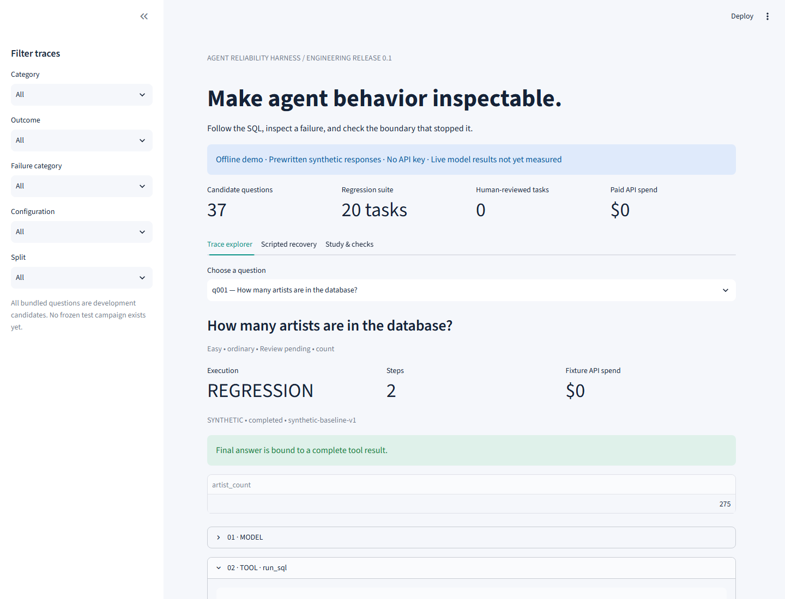
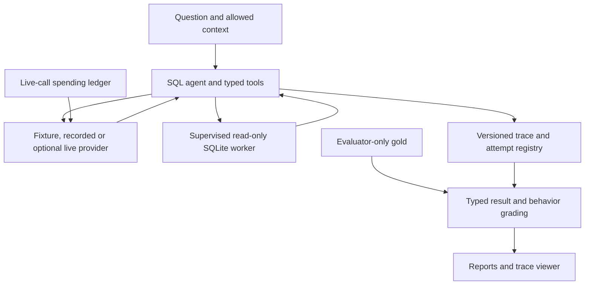

# Agent Reliability Harness — make a SQL agent's behaviour reproducible

[](https://github.com/Jill-Vekariya/agent-reliability-harness/actions/workflows/ci.yml)

[](LICENSE)

**[Explore saved traces](https://jill-vekariya.github.io/agent-reliability-harness/)** · [Architecture](docs/stage6/OVERVIEW.md) · [Recovery case study](docs/stage6/CASE_STUDY.md) · [Review guide](docs/REVIEW_GUIDE.md)



## The problem

SQL agents need more than a plausible final answer: their queries, retrieved rows and tool calls must be inspectable. Agent Reliability Harness combines constrained SQL execution, typed result grading and strict trace replay to distinguish answer failures from tooling regressions. A durable workflow service adds approvals, cancellation, recovery and budget accounting.

## Implementation

- **A constrained tool loop:** four tools (`list_tables`, `describe_table`, `run_sql`, `final_answer`) executed through a supervised, read-only SQLite worker with resource limits, deadlines and child-process cleanup.
- **Typed grading:** final answers are graded against evaluator-only gold results with duplicate-aware row comparison, and an answer that cites rows the agent never retrieved fails.
- **Strict replay:** every provider response and tool call is recorded; a replay that no longer matches the recorded tool contract fails loudly instead of silently passing.
- **A durable workflow service** (FastAPI + PostgreSQL): leased jobs, bounded workers, tenant-scoped auth, one-use approvals, cancellation and budget accounting, with a crash-recovery test that compares table fingerprints after a fresh restore.
- **A spending ledger** for optional live model calls so an experiment cannot run up an unknown bill.

## Results

| Check | Result | Scope |
| --- | --- | --- |
| Docker acceptance, 29 Oct 2026 | **235 tests passed**, six table fingerprints matched after restore | Linux containers, dedicated database |
| v0.3.1 release gate | 148 tests, 29/30 scripted matches plus 7 safety/clarification cases | Scripted fixtures, not live model accuracy |
| [Recovery case study](docs/stage6/CASE_STUDY.md) | Readiness-deadline and PostgreSQL startup failures retained alongside the passing run | What broke before it worked |
| [Dataset card](docs/DATASET_CARD.md) | 37 development tasks, 0 independently reviewed gold tasks | Model-quality claims are deliberately not made |

The recorded results validate execution, grading and recovery behaviour. Model-quality evaluation remains pending a reviewed, held-out task set.

## Where this applies

- **Internal data assistants:** any company letting an agent query a warehouse needs read-only execution, a replayable trace and a way to grade answers before trusting them.
- **Agent platform teams:** record-and-replay is how you separate "the model changed" from "our tools changed" when a regression appears.
- **Compliance and audit:** durable jobs with one-use approvals and an immutable trace are the primitives an auditor asks for.

## Architecture



Gold SQL never enters a model request. The SQL interface is trusted; it does not sandbox hostile Python. [Threat model](docs/THREAT_MODEL.md) · [Design decisions](docs/DECISIONS.md).

## Quick start

Requires Python 3.12, [uv](https://docs.astral.sh/uv/) and Make (Linux/macOS; Windows via Docker).

```bash
git clone https://github.com/Jill-Vekariya/agent-reliability-harness.git
cd agent-reliability-harness
make setup      # install from uv.lock
make ci         # pinned database check, lint, tests, regression gate
make demo       # trace explorer at http://127.0.0.1:8501
```

No model API key is needed. For the durable workflow with PostgreSQL, follow the [local walkthrough](docs/stage6/WALKTHROUGH.md); the verifier script builds the images, runs four jobs, restores from backup and cleans up. Windows launchers live in [`scripts/windows/`](scripts/windows/). Everything else: [reference guide](docs/REFERENCE.md).

## Engineering takeaways

- Recording the provider response is not enough; you also have to record the tool contract, or a replay can pass against tools that no longer exist.
- Crash recovery you have not tested with a real restore is a hope, not a feature.
- Engineering regression results and model-quality benchmarks need separate datasets, review criteria and reporting.

## Limits

- 37 development-exposed tasks, no held-out set, no human-reviewed gold: no model-quality claim is made.
- Local bearer identities are demonstration auth, not production identity.
- Provider adapters have fake-transport coverage only; no recorded live compatibility study.
- A blocked unsafe proposal is still an unsafe agent decision; the harness makes it visible, it does not fix the model.

[Known failures](docs/FAILURES.md) · [Security](SECURITY.md) · [Deployment threat model](docs/stage6/THREATS.md) · [Full reference](docs/REFERENCE.md)


## License

[MIT](LICENSE). Database and dependency rights: [THIRD_PARTY_NOTICES.md](THIRD_PARTY_NOTICES.md). [Contributing](CONTRIBUTING.md) · [Changelog](CHANGELOG.md)
