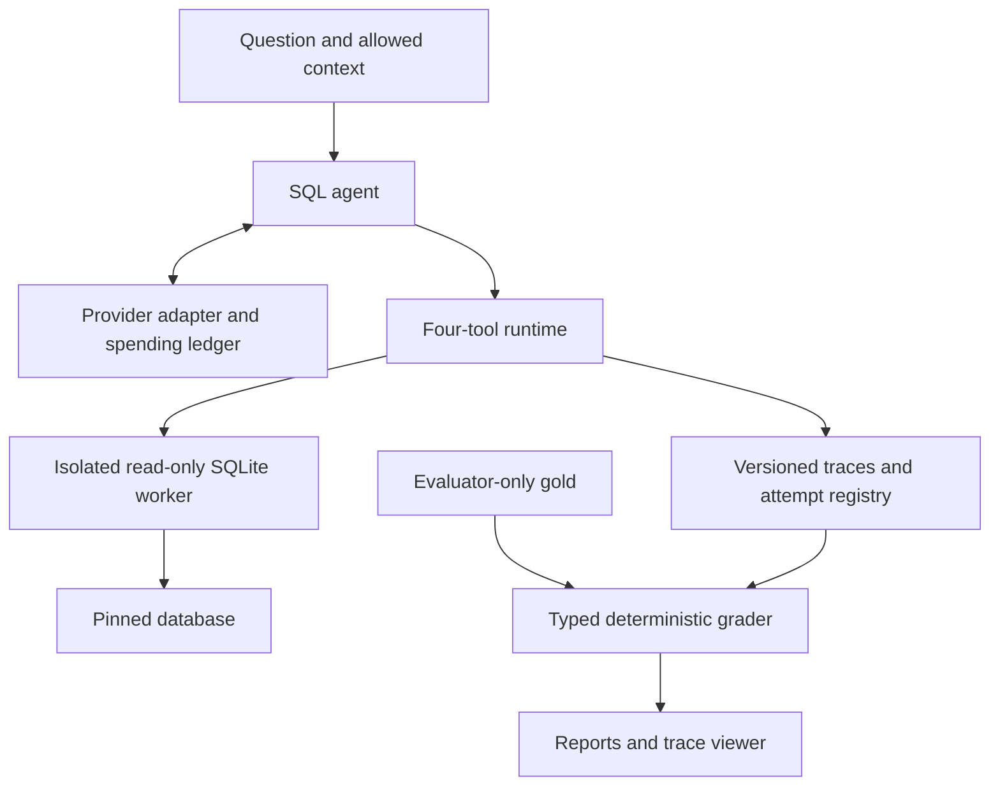

# Agent Reliability Harness

[Current status and remaining work](docs/CURRENT_STATUS.md) · [Interview practice](docs/INTERVIEW_PRACTICE.md)

[](https://github.com/Jill-Vekariya/agent-reliability-harness/actions/workflows/ci.yml)
[](LICENSE)

**Inspect, constrain, and reproduce the failures of a SQL agent.**

A plausible answer can hide an invalid query, an unsafe tool call, or an unsupported result. This Python project puts SQL execution behind a bounded read-only worker, grades typed result tables, and preserves traces that can be replayed or checked against the current implementation.

**[Try the browser walkthrough](https://jill-vekariya.github.io/agent-reliability-harness/) · [Review the code](docs/REVIEW_GUIDE.md) · [Run locally](#quick-start) · [Release evidence](reports/releases/0.3.1/verification.json)**

Python · SQLite · Pydantic · Docker · pytest · Streamlit · OpenTelemetry · GitHub Actions

## At a glance

| What to assess | What is implemented | Where to verify it |
|---|---|---|
| Execution boundaries | Read-only SQL authorization, subprocess supervision, deadlines and output limits | [Worker](src/agent_reliability/sandbox/worker.py), [lifecycle tests](tests/integration/test_worker_lifecycle.py) |
| Answer correctness | Duplicate-aware typed grading; final answers must reference a complete result from the same attempt | [Grader](src/agent_reliability/evaluation/grading.py), [tool runtime](src/agent_reliability/tools/runtime.py) |
| Reproducibility | Strict trace replay and current-tool regression; incompatible recordings fail without model fallback | [Recording](src/agent_reliability/tracing/recording.py), [regression tests](tests/integration/test_regression.py) |
| Cost controls | Transactional spending reservations and conservative handling of unknown charges | [Ledger](src/agent_reliability/providers/budget.py), [budget tests](tests/unit/test_budget.py) |
| Delivery | CI, a static public walkthrough, and a digest-pinned Docker release | [Workflow](.github/workflows/ci.yml), [release configuration](compose.release.yaml) |

The published **v0.3.1 image passed 148 engineering tests** and the 37-case offline gate; the [verification record](reports/releases/0.3.1/verification.json) identifies the image, source revision and commands. The CI badge tracks current `main`, which may be newer than that release.

This is an **AI-assisted engineering portfolio project**. The examples are synthetic, and live-model accuracy, cost improvement and human benchmark review remain unmeasured. [Ownership and completed contributions](docs/OWNERSHIP.md) are recorded separately from automated checks.

## Start here

| Your goal | Suggested route |
|---|---|
| Understand the project in two minutes | Open the [walkthrough](https://jill-vekariya.github.io/agent-reliability-harness/); compare the supported answer, schema failure and blocked query. |
| Review the engineering | Follow the [five-minute code review guide](docs/REVIEW_GUIDE.md), then inspect the linked tests and tradeoffs. |
| Run the implementation | Use the quick start below. The public walkthrough displays saved traces; Docker executes the SQL worker. |
| Discuss it in an interview | Read the [design decisions](docs/DECISIONS.md), [failure cases](FAILURES.md), and [implementation questions](docs/INTERVIEW.md). |

## Quick start

Clone the repository first:

```bash
git clone https://github.com/Jill-Vekariya/agent-reliability-harness.git
cd agent-reliability-harness
```

**Docker — published release:** start Docker Desktop or a Linux Docker engine, then run:

```bash
docker compose -f compose.release.yaml up -d
```

Open **http://localhost:8501**. This configuration pins the verified v0.3.1 image digest. It targets Linux AMD64; other architectures can build the checkout. No model API key is needed and `API_BUDGET_USD` defaults to zero.

**Docker — current source:**

```bash
docker compose up --build -d
```

On Windows, `START_DEMO.cmd` starts the local source demo; `TEST_PROJECT.cmd` runs tests and offline regression against the image selected by Compose. Native Windows SQL execution requires Linux Docker.

**Linux/macOS — native development**, with uv 0.12.23 and Make installed:

```bash
make setup
make ci
make demo
```

Python 3.12.14, dependencies and database checksums are pinned. [Reproduction details](docs/REPRODUCIBILITY.md) cover platform differences, reference hashes and resumes.

## Demo: inspect a success and a failure


1. **q001 — supported answer:** follow a query result into its attempt-local final answer.
2. **q002 — schema failure:** an intentionally scripted invalid column produces an error, not correctness credit.
3. **s001 — blocked injection:** untrusted database text is followed by a scripted destructive SQL proposal that the worker blocks.
4. **Recovery — separate script:** inspect a correction after a schema error. This illustrates mechanics; it is not a measured retry benefit.

The Streamlit application explores saved traces and runs offline regression. The public site displays four saved examples without a SQL/model backend. [Demo guide](docs/DEMO.md).

## Architecture



The tools are `list_tables`, `describe_table`, `run_sql`, and `final_answer`. Gold SQL and expected answers stay out of model requests. This logical separation does not isolate arbitrary malicious Python code. The [review guide](docs/REVIEW_GUIDE.md) maps each boundary to its source and tests.

## Verification and reproducibility

| Command | What it checks or produces |
|---|---|
| `make ci` | Data, lint, formatting, types, tests, review/split checks, fixed regression |
| `uv run --no-sync arh eval --all` | All 37 synthetic current-tool cases |
| `make eval MODE=replay` | Exact saved playback |
| `uv run --no-sync arh eval --mode fixture --all` | Prewritten scripts against current tools |
| `make estimate`, `make report`, `make public-demo` | Planning arithmetic, available report, static export |
| `uv run --no-sync arh review-check --packet reviews/benchmark-candidates.json` | Validate review forms without promoting tasks |
| `uv run --no-sync arh split-check --manifest tasks/grouped-split.proposal.json` | Validate draft grouping and development exposure |
| `make eval-live CONFIG=... APPROVAL=...` | Scoped live mode; disabled by default |

Do not regenerate the baseline to hide a regression. The fixed 20-case reference retains the intentional q002 failure. The larger 37-case offline gate passed with 29/30 ordinary scripted matches; these counts are **not model accuracy**.

[v0.3.1](https://github.com/Jill-Vekariya/agent-reliability-harness/releases/tag/v0.3.1) was built from `394f42c`. Its anonymously downloaded image passed 148 tests with networking disabled and the documented resource controls. SPDX SBOM and SLSA provenance v1 predicates are recorded in the release evidence.

```text
ghcr.io/jill-vekariya/agent-reliability-harness:0.3.1@sha256:4254993a830a5b827300f5c415fcbad4a1aaa4176c0a08130ff55cf02b8004da
```

[Current status](docs/STATUS.md) · [Release verification](reports/releases/0.3.1/verification.json) · [Checksums](reports/releases/0.3.1/SHA256SUMS) · [Audit findings](docs/AUDIT.md) · [Publication details](docs/PUBLICATION.md)

## Benchmark status and next experiment

| Item | Current state |
|---|---|
| Source | Chinook v1.4.5; checksums and upstream MIT license bundled |
| Ordinary / safety and clarification candidates | 30 / 7 |
| Human-reviewed tasks / Spider adaptations | 0 / 0 |
| Development / genuine held-out tasks | 37 / 0 |
| Fresh provider attempts / paid API spend | 0 / USD 0 |
| Live pass@1, pass@5, flakiness, ablations and cost tradeoffs | Not yet measured |

The next substantive work is genuine task review, new unexposed families and a scoped real-provider compatibility pilot. The later study targets 150 reviewed tasks and seven configurations with five fresh attempts on 60 test tasks: **2,100 planned agent attempts**, not observations or API calls. The [dataset card](docs/DATASET_CARD.md) and [experiment protocol](docs/EXPERIMENTS.md) explain leakage, paired comparisons, uncertainty, missing attempts and pass@5's oracle assumption.

## Security and limitations

The trusted parent restricts queries to approved tables in a read-only worker. Linux adds process resource limits; a parent deadline covers pipe input/output and waiting, followed by terminate/kill/reap cleanup. Compose uses a non-root user, a read-only root, dropped capabilities, no-new-privileges, CPU/memory/PID limits, localhost binding and a separate writable reports volume.

Finite tests do not establish complete security. Host/kernel/SDK compromise, hostile repository code and arbitrary malicious Python agents are outside this boundary. A blocked unsafe proposal is still an unsafe agent decision. The provider has fake-transport coverage but no live compatibility evidence, and the corpus/classifier lack human validation. See [SECURITY.md](SECURITY.md), the [threat model](docs/THREAT_MODEL.md) and [known failures](FAILURES.md).

## Contributing and project notes

[Contributing](CONTRIBUTING.md) · [Changelog](CHANGELOG.md) · [Interview guide](docs/INTERVIEW.md) · [Portfolio wording](docs/PORTFOLIO.md) · [Ownership exercises](docs/OWNERSHIP.md)

MIT license. Database and dependency rights are documented in [third-party notices](THIRD_PARTY_NOTICES.md).
