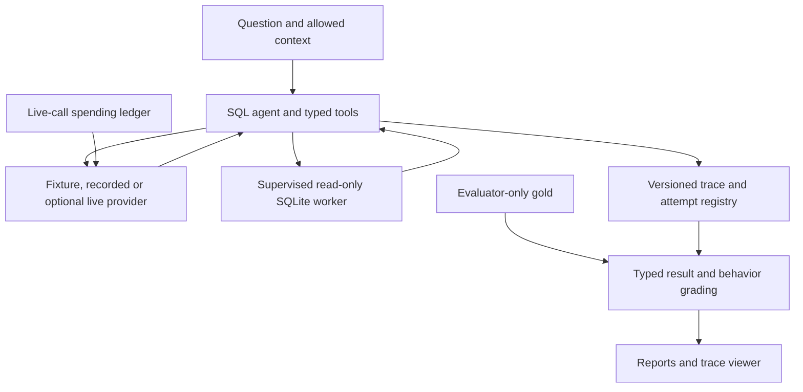

# Agent Reliability Harness

**Reproduce SQL-agent failures and inspect durable job recovery.**

Protected read-only SQL execution, typed result grading and strict trace replay
are paired with a local FastAPI/PostgreSQL workflow for leases, approvals,
tenant isolation and conservative synthetic-budget accounting.

[Live walkthrough — saved traces](https://jill-vekariya.github.io/agent-reliability-harness/)
· [Architecture and decisions](docs/stage6/OVERVIEW.md)
· [Run the local workflow](docs/stage6/WALKTHROUGH.md)
· [Verification](docs/stage6/EVIDENCE.md)
· [Interview route](docs/stage6/INTERVIEW.md)

The public walkthrough displays synthetic saved evidence. The executing API,
SQL workers and PostgreSQL database run locally in Linux containers.

## Reproduce the local workflow

The durable workflow is included in `main` through [PR #19](https://github.com/Jill-Vekariya/agent-reliability-harness/pull/19).
[Stage 7 handover](docs/stage7/HANDOVER.md) records the verified merged revision and remaining limits.
Prerequisites: Git, Python 3.12, uv and Docker with Linux containers/Compose v2.

```bash
git clone --branch main https://github.com/Jill-Vekariya/agent-reliability-harness.git
cd agent-reliability-harness
uv sync --locked --extra workflow
uv run --no-sync python scripts/normalize_evidence.py --fix --output .local/stage5/checkout-001.json
uv run --no-sync arh data
uv run --no-sync python scripts/verify_workflow_deployment.py --project arh-showcase-001 --port 8095 --output .local/stage5/showcase-001
```

These commands also work in PowerShell. Use a new project and receipt path for
each complete run. The verifier builds both images, runs the dedicated-database
suite and four predefined jobs, compares a fresh restore, checks rollback and
removes its containers. It retains volumes and private backups. No model key or
billable call is used. [Manual startup and recovery](docs/LOCAL_DEPLOYMENT.md).

## What was verified locally

| Check on 29 October 2026 | Result |
| --- | --- |
| New locked Python 3.12.14 environment | Installation, dependency check and pinned datasets passed |
| Current Linux Docker images | 235 tests passed; zero failures or skips |
| Bounded deployment | Four jobs succeeded; tenant/auth and trace/metric checks passed |
| Recovery | Six table fingerprints and synthetic-effect records matched after restore |
| Rollback and cleanup | Incompatible image refused; same-image restart verified; both projects stopped |

The [published-source acceptance](docs/stage6/evidence/published-acceptance.json) binds 212
runtime, test and data inputs. This local result does not replace historical CI
counts or claim a cross-version downgrade. [Retained failures and fixes](docs/stage6/CASE_STUDY.md).

## Boundaries and ownership

SQL protections assume trusted project/worker code. Local bearer identities are
demonstration authentication. The corpus has 37 development-exposed tasks,
zero independently reviewed gold tasks and no honest held-out model-quality
result. Unknown synthetic usage remains reserved. [Deployment threat model](docs/stage6/THREATS.md).

Implementation, tests and these materials are **AI-assisted**. Independent owner
coding and review remain pending. [Bounded ownership exercise](docs/stage6/OWNERSHIP_EXERCISE.md)
· [Existing ownership record](docs/OWNERSHIP.md). License and third-party notices
remain [MIT](LICENSE) and [THIRD_PARTY_NOTICES.md](THIRD_PARTY_NOTICES.md).

<details>
<summary>Existing offline setup, release history and detailed limitations</summary>

# Agent Reliability Harness

**Inspect, constrain and reproduce the failures of a SQL agent.**

The harness separates a provider-driven tool loop, protected SQL execution, typed result grading and trace persistence. It catches unsupported final answers and preserves incompatible or failed attempts instead of silently making a regression pass.

[Browser walkthrough](https://jill-vekariya.github.io/agent-reliability-harness/) · [Code review route](docs/REVIEW_GUIDE.md) · [Interview guide](docs/INTERVIEW.md) · [Design decisions](docs/DECISIONS.md)

The browser walkthrough displays saved synthetic traces. The Python/Docker application executes the SQL worker; the public site is not a SQL or model API.

## Implemented boundaries

| Component | Behavior | Evidence |
| --- | --- | --- |
| SQL worker | Read-only authorization, resource/output limits, parent deadline and child cleanup | [Worker](src/agent_reliability/sandbox/worker.py), [lifecycle tests](tests/integration/test_worker_lifecycle.py) |
| Answer grading | Typed, duplicate-aware rows; final answers reference complete attempt-local results | [Grader](src/agent_reliability/evaluation/grading.py), [tool runtime](src/agent_reliability/tools/runtime.py) |
| Reproduction | Exact replay versus current-tool regression; incompatible recordings fail, including on resume | [Recording](src/agent_reliability/tracing/recording.py), [regression tests](tests/integration/test_regression.py) |
| Optional live calls | Transactional exposure reservations; unknown charges remain unresolved | [Budget ledger](src/agent_reliability/providers/budget.py), [provider tests](tests/unit/test_provider_hardening.py) |

## Architecture



Gold SQL stays out of model requests. The four tools are `list_tables`, `describe_table`, `run_sql` and `final_answer`. This trusted SQL interface does not isolate arbitrary hostile Python code. [Threat model](docs/THREAT_MODEL.md).

## Quick start

Requires Git, Python 3.12, uv, Make and dependency-download access. Native SQL execution uses Linux/macOS; Windows uses Linux Docker.

```bash
git clone https://github.com/Jill-Vekariya/agent-reliability-harness.git
cd agent-reliability-harness
make setup
make ci
make demo
```

Open `http://127.0.0.1:8501`. `make setup` installs from `uv.lock`; `make ci` materializes/checks the pinned database before running quality and regression gates. No provider key is needed. [Reproduction and platform details](docs/REPRODUCIBILITY.md).

For current-source Docker, start a Docker Linux engine and run `docker compose up --build -d`; stop with `docker compose down`, preserving the reports volume. The separately recorded v0.3.1 image contains older dependencies, including affected Pillow versions; its digest/receipt is retained as historical evidence rather than an updated security release. No replacement versioned image is claimed here. [Docker demo guide](docs/DEMO.md).

## Optional durable local jobs

The [durable workflow](docs/WORKFLOW_CONTROLS.md) extends Harness with FastAPI,
PostgreSQL leases, bounded workers, tenant-scoped local demo authentication,
one-use action approvals, cancellation and synthetic budget accounting. Workflow
state stays separate from agent-accessible read-only SQLite. Live providers remain
disabled. See the exact revision and source-linked verification limits in the
Stage 2 report before claiming database or Docker behavior demonstrated.
The [Stage 1 contract](docs/DURABLE_EXECUTION.md) is retained as historical evidence.

## Results and verification

| Evidence | Actual result | Limit |
| --- | --- | --- |
| [v0.3.1 receipt](reports/releases/0.3.1/verification.json) | 148 tests passed; 37-case offline gate passed; source `394f42c2674d1d2135adaf0606f9fc789fef967c` | Historical published image, not the test count at every newer revision |
| Same release gate | 29/30 ordinary scripted matches; seven additional safety/clarification cases | Prewritten scripts, not measured model accuracy |
| [Stage 4 local review](docs/INTERVIEW.md) | 46 selected execution/grading/budget/replay tests passed | Focused subset on the reviewed source; no live provider call |
| [Dataset status](docs/DATASET_CARD.md) | 37 exposed development tasks; zero genuinely held-out tasks and zero recorded human gold reviews | Independent empirical claims remain open |

From the installed checkout:

```bash
make ci
uv run --no-sync arh eval --all
make eval MODE=replay
python scripts/check_links.py
```

`eval --all` executes today's tools against saved responses; replay displays the saved trace. Neither creates fresh model attempts. q002 deliberately contains a scripted schema failure. Do not regenerate its baseline to hide a regression. The [release receipt](reports/releases/0.3.1/verification.json) also identifies the image digest, resource controls and recorded provenance.

## Limits and next work

The 27 October 2026 dependency review updates the source lock to Pillow 13.0.0, the compatible Streamlit 1.66.1 patch release, and certifi 2026.10.19. The latter removes the compromised emSign ECC Root CA - G3 trust anchor described in [GHSA-6q48-6c7w-9gw2](https://github.com/advisories/GHSA-6q48-6c7w-9gw2); a regression test checks the certificate fingerprint in the bundled CA file. The full local gate passed 150 tests, lint, formatting, types and fixed regression. The three bundled PNG screenshots also decoded successfully during the Pillow update. GitHub marked all 41 reviewed Pillow alerts fixed after the initial merge; current alert status must be checked against the merged lockfile and GitHub's rescan. These are specific advisory/dependency updates, not a blanket security certification.

Provider adapters have fake-transport coverage, with no recorded live compatibility or model-quality study. A blocked unsafe proposal is still an unsafe agent decision. Self-contained checksums need a trusted reference; they do not authenticate a maliciously replaced corpus. [Known failures](FAILURES.md) · [Security](SECURITY.md) · [Experiment plan](docs/EXPERIMENTS.md).

Next: genuine gold review, new unexposed task families and a scoped, explicitly budgeted provider pilot. Planned sample sizes and configurations are not completed observations.

## Ownership and license

The goal/requirements were user-supplied; implementation, candidate tasks, tests and documentation were AI-assisted. Personal review/coding exercises remain pending unless supported by actual evidence in [OWNERSHIP.md](docs/OWNERSHIP.md). No independent authorship, production usage or business savings are inferred.

Repository license: [MIT](LICENSE). Database/dependency rights: [third-party notices](THIRD_PARTY_NOTICES.md). [Contributing](CONTRIBUTING.md) · [Changelog](CHANGELOG.md) · [Interview practice](docs/INTERVIEW_PRACTICE.md).

## Workflow measurement

[The Stage 3 protocol and driver](docs/WORKFLOW_MEASUREMENT.md) measure synthetic
worker failure, terminal coverage, tenant isolation, effect deduplication and
budget conservation. Initial failures are retained separately from the amended
protocol. Live model quality remains blocked by independent review and unseen
task-family requirements; development fixtures are not a held-out test set.


</details>
