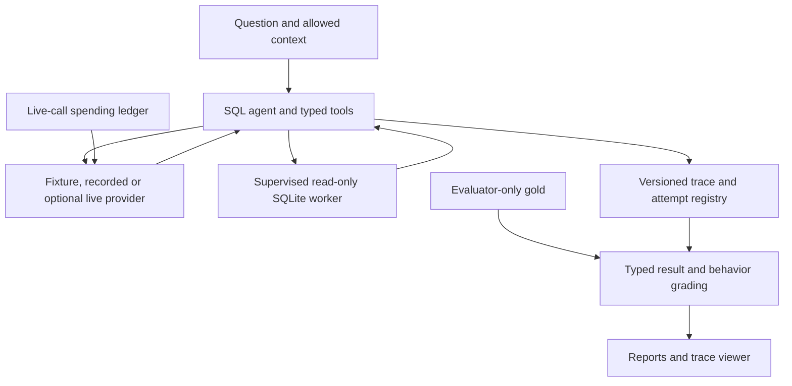

# Agent Reliability Harness

**Inspect, constrain and reproduce the failures of a SQL agent.**

The harness separates a provider-driven tool loop, protected SQL execution, typed result grading and trace persistence. It catches unsupported final answers and preserves incompatible or failed attempts instead of silently making a regression pass.

[Browser walkthrough](https://jill-vekariya.github.io/agent-reliability-harness/) · [Code review route](docs/REVIEW_GUIDE.md) · [Interview guide](docs/INTERVIEW.md) · [Design decisions](docs/DECISIONS.md)

The browser walkthrough displays saved synthetic traces. The Python/Docker application executes the SQL worker; the public site is not a SQL or model API.

## Implemented boundaries

| Component | Behavior | Evidence |
| --- | --- | --- |
| SQL worker | Read-only authorization, resource/output limits, parent deadline and child cleanup | [Worker](src/agent_reliability/sandbox/worker.py), [lifecycle tests](tests/integration/test_worker_lifecycle.py) |
| Answer grading | Typed, duplicate-aware rows; final answers reference complete attempt-local results | [Grader](src/agent_reliability/evaluation/grading.py), [tool runtime](src/agent_reliability/tools/runtime.py) |
| Reproduction | Exact replay versus current-tool regression; incompatible recordings fail, including on resume | [Recording](src/agent_reliability/tracing/recording.py), [regression tests](tests/integration/test_regression.py) |
| Optional live calls | Transactional exposure reservations; unknown charges remain unresolved | [Budget ledger](src/agent_reliability/providers/budget.py), [provider tests](tests/unit/test_provider_hardening.py) |

## Architecture



Gold SQL stays out of model requests. The four tools are `list_tables`, `describe_table`, `run_sql` and `final_answer`. This trusted SQL interface does not isolate arbitrary hostile Python code. [Threat model](docs/THREAT_MODEL.md).

## Quick start

Requires Git, Python 3.12, uv, Make and dependency-download access. Native SQL execution uses Linux/macOS; Windows uses Linux Docker.

```bash
git clone https://github.com/Jill-Vekariya/agent-reliability-harness.git
cd agent-reliability-harness
make setup
make ci
make demo
```

Open `http://127.0.0.1:8501`. `make setup` installs from `uv.lock`; `make ci` materializes/checks the pinned database before running quality and regression gates. No provider key is needed. [Reproduction and platform details](docs/REPRODUCIBILITY.md).

For current-source Docker, start a Docker Linux engine and run `docker compose up --build -d`; stop with `docker compose down`, preserving the reports volume. The separately recorded v0.3.1 image contains older dependencies, including affected Pillow versions; its digest/receipt is retained as historical evidence rather than an updated security release. No replacement versioned image is claimed here. [Docker demo guide](docs/DEMO.md).

## Optional durable local jobs

The [durable execution extension](docs/DURABLE_EXECUTION.md) adds FastAPI,
PostgreSQL job/attempt state, leased workers and bounded synthetic crash/recovery
demonstrations around the existing SQL agent. Workflow storage stays separate
from agent-accessible read-only SQLite. This Stage 1 service is local-only, has
no tenant authentication and exposes no live provider. See the exact verification
receipt before treating configured recovery behavior as executed evidence.

## Results and verification

| Evidence | Actual result | Limit |
| --- | --- | --- |
| [v0.3.1 receipt](reports/releases/0.3.1/verification.json) | 148 tests passed; 37-case offline gate passed; source `394f42c2674d1d2135adaf0606f9fc789fef967c` | Historical published image, not the test count at every newer revision |
| Same release gate | 29/30 ordinary scripted matches; seven additional safety/clarification cases | Prewritten scripts, not measured model accuracy |
| [Stage 4 local review](docs/INTERVIEW.md) | 46 selected execution/grading/budget/replay tests passed | Focused subset on the reviewed source; no live provider call |
| [Dataset status](docs/DATASET_CARD.md) | 37 exposed development tasks; zero genuinely held-out tasks and zero recorded human gold reviews | Independent empirical claims remain open |

From the installed checkout:

```bash
make ci
uv run --no-sync arh eval --all
make eval MODE=replay
python scripts/check_links.py
```

`eval --all` executes today's tools against saved responses; replay displays the saved trace. Neither creates fresh model attempts. q002 deliberately contains a scripted schema failure. Do not regenerate its baseline to hide a regression. The [release receipt](reports/releases/0.3.1/verification.json) also identifies the image digest, resource controls and recorded provenance.

## Limits and next work

The 27 October 2026 dependency review updates the source lock to Pillow 13.0.0, the compatible Streamlit 1.66.1 patch release, and certifi 2026.10.19. The latter removes the compromised emSign ECC Root CA - G3 trust anchor described in [GHSA-6q48-6c7w-9gw2](https://github.com/advisories/GHSA-6q48-6c7w-9gw2); a regression test checks the certificate fingerprint in the bundled CA file. The full local gate passed 150 tests, lint, formatting, types and fixed regression. The three bundled PNG screenshots also decoded successfully during the Pillow update. GitHub marked all 41 reviewed Pillow alerts fixed after the initial merge; current alert status must be checked against the merged lockfile and GitHub's rescan. These are specific advisory/dependency updates, not a blanket security certification.

Provider adapters have fake-transport coverage, with no recorded live compatibility or model-quality study. A blocked unsafe proposal is still an unsafe agent decision. Self-contained checksums need a trusted reference; they do not authenticate a maliciously replaced corpus. [Known failures](FAILURES.md) · [Security](SECURITY.md) · [Experiment plan](docs/EXPERIMENTS.md).

Next: genuine gold review, new unexposed task families and a scoped, explicitly budgeted provider pilot. Planned sample sizes and configurations are not completed observations.

## Ownership and license

The goal/requirements were user-supplied; implementation, candidate tasks, tests and documentation were AI-assisted. Personal review/coding exercises remain pending unless supported by actual evidence in [OWNERSHIP.md](docs/OWNERSHIP.md). No independent authorship, production usage or business savings are inferred.

Repository license: [MIT](LICENSE). Database/dependency rights: [third-party notices](THIRD_PARTY_NOTICES.md). [Contributing](CONTRIBUTING.md) · [Changelog](CHANGELOG.md) · [Interview practice](docs/INTERVIEW_PRACTICE.md).
