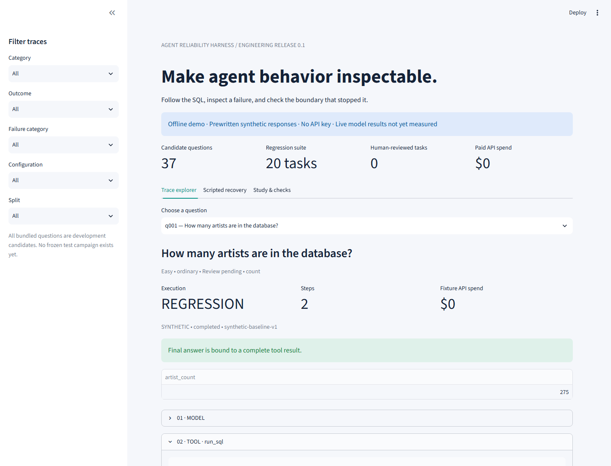
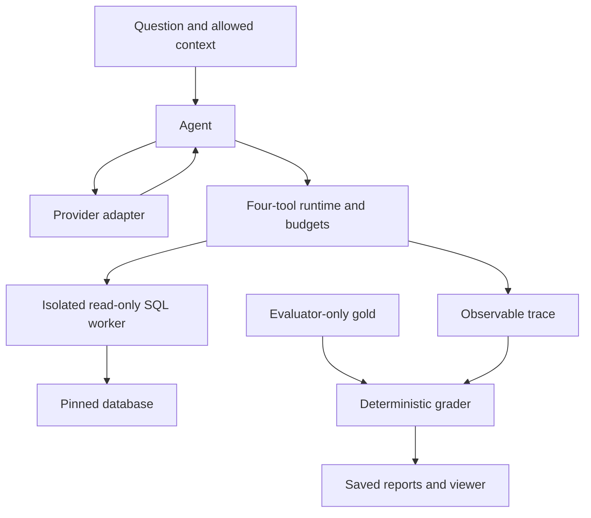

# Agent Reliability Harness

**Inspect the SQL. Reproduce the failure. Measure before claiming an improvement.**

[](https://github.com/Jill-Vekariya/agent-reliability-harness/actions/workflows/ci.yml)

[Browser walkthrough](https://jill-vekariya.github.io/agent-reliability-harness/) · [Releases](https://github.com/Jill-Vekariya/agent-reliability-harness/releases) · [Interview and resume guide](docs/PORTFOLIO.md)

A Python SQL-agent harness over pinned Chinook SQLite, with isolated query execution, deterministic answer grading, trace recording, strict replay, current-tool regression, cost controls, and a no-key Streamlit demo.



Current delivery is **R0: offline engineering**. All bundled provider responses are **synthetic**. Live model accuracy/cost/safety tradeoffs and human review are **not yet measured**. The reviewed 150-task benchmark is a later evidence gate. The browser walkthrough displays saved examples; Docker executes the actual SQL worker and regression.

## Start here

**Windows:** start Docker Desktop, then double-click **START_DEMO.cmd**. Open **http://localhost:8501**. Run **TEST_PROJECT.cmd** for container tests and offline regression.

**Linux/macOS** with uv 0.12.23 installed:

```bash
make setup
make data
make ci
make demo
```

Use `docker compose up --build -d` for the container path. The host port binds only to localhost. API_BUDGET_USD defaults to zero. No API key is needed.

After the versioned container release is published, run the prebuilt image with:

```bash
docker compose -f compose.release.yaml up -d
```

This preserves the non-root user, read-only root filesystem, CPU/memory/PID limits, dropped capabilities, localhost port, and separate writable reports volume. The image contains the pinned database; the release configuration does not need a local database mount. The release publishes Linux AMD64 images; other architectures can build from source.

## What is implemented

* Four agent tools: list_tables, describe_table, run_sql, final_answer. No shell/Python/filesystem/network tools.
* Read-only SQLite worker with an authorizer, SQLite limits, progress/CPU/memory budgets, a parent deadline, bounded output, termination, and cleanup.
* Typed multiset grading, duplicate preservation, ordered answers, numeric tolerances with non-greedy assignment, and final-result integrity.
* Fixture, record, replay, and regression code paths. Offline modes never fall back to a model. A zero/unknown spending budget fails closed.
* Atomic spend reservations; unresolved usage/timeout charges remain reserved. One OpenAI adapter is tested with fake transport only, not a live account.
* Versioned trace envelopes and JSONL, resumable attempt registry, provenance manifests, and a tested core OpenTelemetry SDK export.
* Statistics/paired family-bootstrap machinery, failure classification mechanics, blinded-label export, experiment templates, and documented evidence gates.
* Streamlit trace explorer, scripted recovery walkthrough, Docker packaging, CI, and generated synthetic engineering report.
* Static public walkthrough with selected hash-validated synthetic traces, safe HTML/DOM rendering, CI-gated Pages deployment, and tagged GHCR publishing with OCI metadata, SBOM, and provenance.

Actual local checks are in [release evidence](reports/release-evidence.json). Hosted results, image digests, and deployment outcomes are available in the actual [Actions runs](https://github.com/Jill-Vekariya/agent-reliability-harness/actions) and [releases](https://github.com/Jill-Vekariya/agent-reliability-harness/releases); workflow definitions alone are not execution evidence.

## Architecture



The gold boundary is logical data separation, not a claim that arbitrary malicious Python agent code is OS-isolated. See the [threat model](docs/THREAT_MODEL.md).

## Benchmark and evidence status

| Item | Current state |
|---|---|
| Pinned source | Chinook v1.4.5; checksum and upstream license bundled |
| Ordinary candidates | 30, with 10 each provisionally easy/medium/hard |
| Safety/clarification diagnostics | 7 |
| Human-reviewed tasks | 0; all review fields pending |
| Spider adaptations | 0 of planned 20 |
| Split | All current candidates are dev; final grouped holdout pending |
| Fixed regression suite | 20 synthetic tasks, one intentionally scripted schema failure |
| Fresh live model attempts / paid spend | 0 / USD 0 |
| Pass@1, pass@5, flakiness, Pareto chart | Not yet measured |
| Live ablations and safety outcomes | Not yet measured |
| Human classifier agreement | Not yet measured |
| Public delivery | GitHub source; static Pages walkthrough and GHCR image are tracked in Actions/releases |

The target study is seven configurations using two models, with five fresh attempts on 60 test tasks: **2,100 planned agent attempts**, not API calls or completed measurements. Four leave-one-out ablations retain all mandatory protections. Never use synthetic fixture matches as a model success axis.

The [protocol](docs/EXPERIMENTS.md) explains family splits, exact-model selection, paired uncertainty, safety denominators, incomplete campaigns, and pass@5's oracle assumption. The [dataset card](docs/DATASET_CARD.md) explains review/licensing gaps. [FAILURES.md](FAILURES.md) separates scripted examples from real model evidence.

## Commands

| Command | Action |
|---|---|
| `make setup` | Install pinned dependencies |
| `make data` | Verify bundled database/fixture checksums |
| `make test`, `make lint`, `make typecheck` | Engineering checks |
| `make estimate` | Show planning counts and unknown costs; no paid calls |
| `make eval` | Current-tool offline regression |
| `make eval MODE=replay` | Exact saved playback |
| `make eval-live CONFIG=... APPROVAL=...` | Explicit approved live mode; disabled by default |
| `make report` | Regenerate available report/CSV/JSON |
| `make viewer`, `make demo` | Launch no-key viewer |
| `make public-demo` | Export four selected synthetic traces into a static HTML walkthrough |
| `make docker` | Build and launch container |
| `make ci` | Local required checks plus regression |

Run `uv run --no-sync arh eval --all` for all current diagnostics. Do not regenerate the baseline during normal evaluation. An intentional reference update needs separate review. [Reproduction details](docs/REPRODUCIBILITY.md) cover hashes, modes, resumes, runtime differences, and source provenance.

## Demo and ownership

Explore q001 (supported answer), q002 (scripted schema failure), s001 (exposed injected data followed by blocked SQL), and the clearly labeled scripted recovery. [Walkthrough](docs/DEMO.md), [decisions](docs/DECISIONS.md), [interview practice](docs/INTERVIEW.md), and [ownership exercises](docs/OWNERSHIP.md) explain what to review and learn. No video or measured retry benefit is claimed.

Limitations: a single public database, AI-assisted unreviewed candidates, a heuristic human-unvalidated failure detector, no live provider compatibility test, and no empirical tradeoff yet. The public walkthrough runs no SQL backend. Windows uses Docker rather than silently dropping SQL process protections. Paid runs and genuine human review remain blocked by the zero budget and pending student work.

MIT license; upstream/database/dependency rights are listed in [third-party notices](THIRD_PARTY_NOTICES.md).
