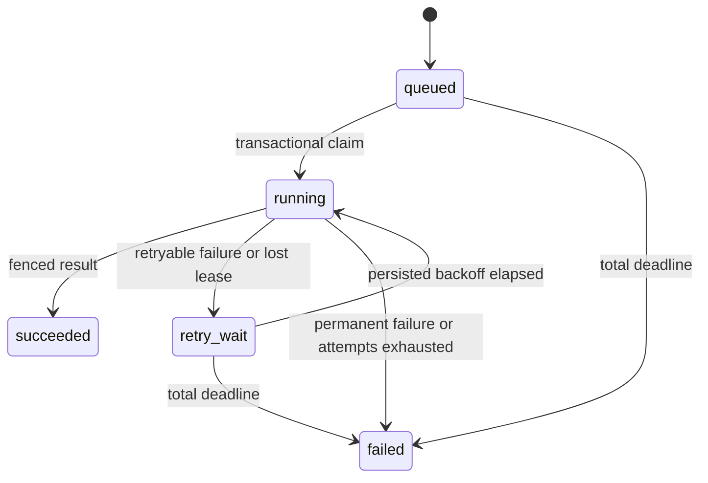

# Durable fixture jobs — Stage 1

Historical contract for `bfd4d6f`. On the Stage 2 branch, use
[Workflow controls](WORKFLOW_CONTROLS.md) for current authentication, approvals,
cancellation, setup and verification commands. Recorded Stage 1 evidence remains
linked to its original revision.

This optional local extension admits and recovers bounded synthetic SQL-agent jobs.
It preserves the offline CLI, historical recordings, grading and read-only SQLite
sandbox. It is not a generic command runner or a public multi-tenant service.
No live provider is constructed. All demonstration effects are synthetic.

## Complete local setup

Use an unused Compose project name beginning with `arh-stage1-`. Requirements:
Git, Python 3.12, uv, a Docker Linux engine, Compose v2, and dependency/image access.

```bash
make setup
python scripts/configure_workflow.py
docker compose --env-file .env.workflow -f compose.workflow.yaml -p arh-stage1-demo build
docker compose --env-file .env.workflow -f compose.workflow.yaml -p arh-stage1-demo up -d --wait
curl http://127.0.0.1:8091/ready
curl -H 'Content-Type: application/json' -H 'Idempotency-Key: interview-1' \
  -d '{"task_id":"q001"}' http://127.0.0.1:8091/jobs
curl http://127.0.0.1:8091/jobs
```

Windows uses Docker Linux and `py -3.12` for the configuration/verifier scripts;
use `curl.exe` or PowerShell Invoke-RestMethod with equivalent JSON. Native durable
workers require Linux process groups and parent-death signaling.

The API binds host loopback only and joins a separate ingress bridge so Docker can
publish that port. Workers and PostgreSQL stay on the internal workflow network;
PostgreSQL has no published host port. This is not authentication: other local
processes can reach the API.
The database credential file is generated once, ignored and never printed.
Do not replace it on an existing installation. Unix mode 0600 is requested; this
does not establish Windows ACL protection. Do not expose this Stage 1 API publicly.

The one-shot migration service initializes only the workflow database. The isolated
PostgreSQL volume also creates `arh_workflow_tests` for checks. It does not use
ReleaseLens's database. Keep the existing viewer Compose file/service unchanged.

## State and delivery contract



Jobs persist resolved inputs/provenance, identity, timestamps, state, attempts,
absolute deadline and result. Attempts retain worker identity, heartbeat,
outcome/error, final trace when available and stale-result rejection counts.
A crash can lose unreturned in-memory trace events; its attempt row remains.
Evaluation correctness is separate from execution completion: q002 may finish a
workflow successfully with `grade.correct=false`. A refusal or wrong answer is
not automatically retried to improve apparent model quality.

Admission uniquely binds `(local-demo, Idempotency-Key)` to the canonical validated
request and task/script/database/source/lock/limit provenance. Repeated equivalent
requests return the original job (200); new jobs return 201; conflicting payloads
return 409, including simultaneous admissions. Keys are retained with jobs.
Changes to the trusted execution source may intentionally make old requests
incompatible: workers fail closed rather than silently changing their meaning.
No arbitrary SQL, database path, model/provider or resource limit is accepted.

Claiming uses a short PostgreSQL transaction with `FOR UPDATE SKIP LOCKED`. Each
claim increments the durable attempt number and creates a fresh token. Heartbeats
cannot revive expired ownership. Finish rechecks token, attempt and PostgreSQL
time at the actual update after lock acquisition. Terminal job rows are immutable.
The source database is available only as read-only SQLite through the original
sandbox; workflow credentials and inherited provider/proxy/PYTHONPATH variables
are excluded from the executor, whose SQL subprocess has its original minimal
environment and limits.

Defaults: three total attempts, 30 seconds per attempt, 120 seconds total,
15-second lease, five-second heartbeat, 0.2-second polling, exponential backoff
starting at 0.5 seconds and capped at five. Admission persists attempt/retry/deadline
policy, so another worker cannot increase an existing job's retry cap or timeout.
Backoff is deterministic and persisted; synchronized retries can still create
contention. Stage 3 will measure this before adding jitter or a broker.

A supervisor renews leases outside the synchronous agent loop, bounds input/output
and terminates/reaps an attempt process group. Linux parent-death signaling closes
the worker-kill orphan window after startup. The executor verifies its expected
parent to close the pre-registration race. Container init assists reaping.
Database/heartbeat failure stops local execution conservatively; unknown state is
recovered through the lease. Unavailable database/worker time has no delivery SLA.
The total deadline is an eligibility/result-commit boundary; a worker must reconcile
expired jobs before their terminal status becomes visible. It is not a physical
preemption guarantee during a host pause or a database outage.

The contract is **at-least-once attempts**, conditional on eventual database and
worker availability and bounded by retry/deadline policy. Recovery re-executes
the whole attempt. There is no tool-step checkpointing or exactly-once external
effect guarantee. A database commit can succeed even when its acknowledgment is
lost; later reads establish the outcome. A token protects the workflow result,
not a remote system that does not honor an idempotency/fencing mechanism.

## Verification

```bash
make ci
docker compose --env-file .env.workflow -f compose.workflow.yaml -p arh-stage1-demo run --rm checks
python scripts/verify_durable_workflow.py --project arh-stage1-demo --output .local/stage1/demo-001.json
```

Use a new receipt path for every run; failed receipts are never replaced.
The default local gate reports PostgreSQL tests skipped without
`ARH_WORKFLOW_TEST_DATABASE_URL`. Compose supplies a dedicated test database;
each test creates and retains its own schema. These schemas and failed attempts
are not deleted to make later checks pass. The CI PostgreSQL job is configuration
until a push is separately authorized and its exact revision runs.

The verifier operates only on the specified owned `arh-stage1-*` stack. It:
restarts the API with queued/active jobs; kills a worker after a synthetic effect;
submits duplicates and a conflicting payload; runs two competing workers;
pauses one worker through lease expiry and verifies a stale-result rejection;
and exhausts retries while preserving the failure across API restart.

The independent SQLite effect sink records committed sink invocations and uniquely keys
a logical effect by job identity with a payload hash. Two recovered invocations
must produce one committed synthetic effect. This proves the adapter's explicit
deduplication rule, not exactly-once effects for email, money or infrastructure.

Receipts contain source revision plus dirty/source hashes, environment, commands,
exit codes, HTTP observations, attempts, final results and logs. No full container
environment or credential file is dumped. Process tests verify timeout/lease-loss
cleanup; PostgreSQL tests cover admission races, competing claims, lock-wait expiry,
retry caps, migrations, invalid transitions and API input boundaries.

## Alternatives and operational limits

PostgreSQL avoids a second queue/broker while making ownership transactional.
Its polling/connections and manual migration/lifecycle code are additional work.
Connections are short-lived per operation; throughput has not been benchmarked.
SQLite remains appropriate for the original single-run CLI; it is not used to
simulate PostgreSQL locking tests. Temporal becomes worth considering if measured
requirements need durable branching/activity replay or operational tooling that
outweighs another service and SDK.

Normal builds use the pinned Python base and the source dependency lock. Docker
network/image access failures must remain recorded. For an explicitly documented
local fallback, `ARH_WORKFLOW_BASE_IMAGE` and `ARH_WORKFLOW_POSTGRES_IMAGE` accept
operator-selected immutable image references. Reusing a cached image does not
reuse another project's database. Validate the resulting Python/package versions,
source fingerprint and test results; do not present a fallback as a fresh default
build. A build-local DNS host mapping does not fix global Docker DNS.

Liveness (`/live`) does not access PostgreSQL; readiness (`/ready`) requires the
workflow migration. Logs use fixed event names and request/job/attempt identifiers.
Budgeted live calls, tenant authorization, human action approvals and cancellation
are Stage 2. Shared provider budgeting, backup/restore, richer metrics/tracing,
production authentication and public deployment are not implemented claims here.
The existing CLI's local ledger and campaign approval remain distinct.

Stop only this stack, retaining persistent state:

```bash
docker compose --env-file .env.workflow -f compose.workflow.yaml -p arh-stage1-demo down
```

Do not use `down -v` on evidence you need. Data deletion, replacing existing
services, publishing images and paid/public deployment need their own authorization.
