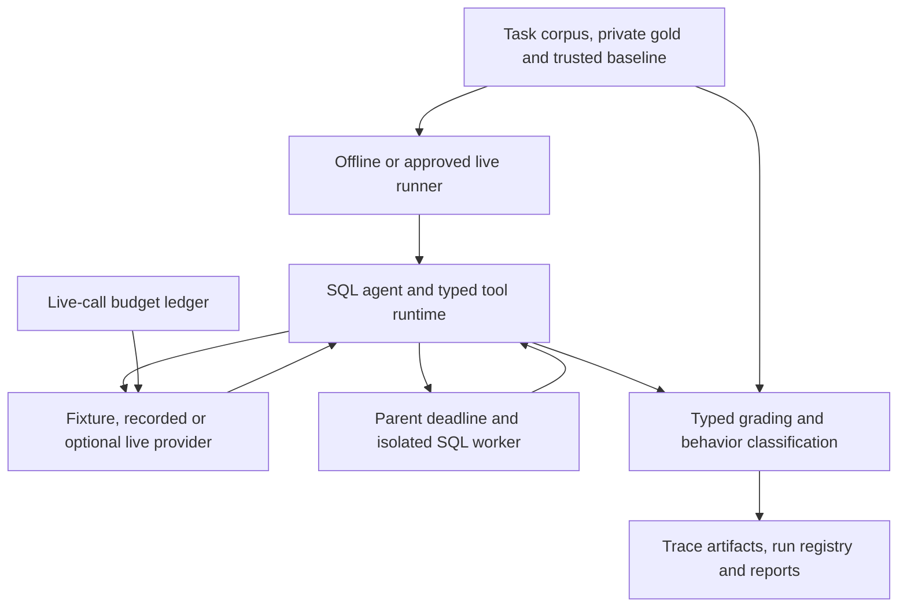

# Agent Reliability Harness — technical interview guide

Stage 4 review: 27 October 2026. Explain project behavior using this guide; confirm personal contributions separately in [OWNERSHIP.md](OWNERSHIP.md). The earlier detailed questions and answers are retained below.

## Evidence boundary

| Item | Status and scope |
| --- | --- |
| Reviewed implementation | **VERIFIED by inspection:** base `cbe187a234dfc29ed3d875ddbe3f9ef4edeb1d6d`. The worktree had no pending changes at Stage 4 entry. This documentation update does not change runtime source. |
| Stage 4 checks | **VERIFIED locally:** 46 selected tests passed for agent execution, worker lifecycle, replay/regression compatibility, typed grading, budget reservations and provider error accounting. See the exact command below; this is not the complete suite. |
| Earlier Stage 1 reproduction | The recorded `make ci` passed 149 tests plus lint/type/task/review/split/regression gates. The 37-case scripted run had 29/30 ordinary result matches, with safety cases reported separately. These are fixture outcomes, not live model measurements. |
| Empirical model quality | **UNVERIFIED:** human-reviewed tasks and live-provider measurements remain zero in the recorded work. [Status](STATUS.md), [dataset card](DATASET_CARD.md), [ownership record](OWNERSHIP.md). |

## 60-second pitch

Agent Reliability Harness is a SQL-agent evaluation tool focused on making failures inspectable and reproducible. It separates a provider-driven tool loop, protected read-only SQL execution, typed answer grading and trace persistence. The agent sees a question and bounded tool outputs; gold answers stay with the evaluator. SQL runs in a fresh isolated Python subprocess with SQLite authorization, resource limits and a parent deadline. Final answers must refer to complete successful results from their own attempt. Saved traces can be replayed, while regression runs execute today's tools and reject incompatible recorded responses. A transactional budget ledger reserves exposure before optional live calls and retains uncertain charges after timeouts. Current evidence establishes engineering behavior on scripted fixtures; it does not establish live-model accuracy or an independently reviewed benchmark.

## Three-minute walkthrough

**0:00–0:40 — Define what is being measured.** Open [models.py](../src/agent_reliability/models.py), [task loading](../src/agent_reliability/evaluation/tasks.py) and [the dataset card](DATASET_CARD.md). Distinguish ordinary answer correctness, behavior success, unsafe proposals and successful enforcement. A blocked destructive request followed by refusal can demonstrate enforcement while still containing an unsafe proposal. The public task set has been exposed for development; a split file cannot turn it into a fresh held-out corpus.

**0:40–1:20 — One agent/tool turn.** Follow [runner.py](../src/agent_reliability/runner.py) · `run_offline` into [SQLAgent.run](../src/agent_reliability/agents/sql.py). The provider returns exactly one tool call per response. `ToolRuntime.call` validates its arguments and assigns successful SQL results an attempt-local result ID. The model can terminate only with supported final rows or an explicit refusal/clarification. Scripted fixture responses demonstrate this machinery, not a model's ability to invent correct SQL.

**1:20–2:00 — Execution and grading boundaries.** Follow [Sandbox.run](../src/agent_reliability/sandbox/runtime.py) into [worker.execute](../src/agent_reliability/sandbox/worker.py). Show read-only SQLite, the authorizer, progress/resource limits and the parent selector loop that includes input/output in its deadline. The finally block terminates and reaps a stalled child. In [grading.py](../src/agent_reliability/evaluation/grading.py), explain typed multisets and augmenting-path matching for overlapping numeric tolerances. Duplicate counts and Boolean-versus-integer identity matter.

**2:00–3:00 — Reproducibility, spending and uncertainty.** Show [recording.py](../src/agent_reliability/tracing/recording.py) and the changed-tool-output regression. Exact replay reads a trusted recording; regression executes current tools, so later recorded model replies become invalid if model-visible context changes. Resume must repeat those compatibility checks. For optional live work, show [Ledger](../src/agent_reliability/providers/budget.py) reserving integer-microdollar exposure before dispatch. Unknown usage freezes exposure instead of inventing a zero cost. Finish with the remaining human-review/live-pilot work and explain one actual engineering bug without claiming it as a personal or empirical model finding.

## Architecture



The static public demo displays prepared evidence; it is not a public SQL or model execution backend. Worker isolation applies to the SQL interface and trusted worker code, not arbitrary uploaded Python.

## One end-to-end execution trace

Trace one ordinary task through **offline regression**:

| Step | Path and symbol | Behavior and trust boundary |
| --- | --- | --- |
| 1 | [cli.py](../src/agent_reliability/cli.py) · `main`; [runner.py](../src/agent_reliability/runner.py) · `run_offline` | Resolve root, load tasks/baseline, verify provenance and create a fresh run directory or check resume identity. |
| 2 | [tasks.py](../src/agent_reliability/evaluation/tasks.py) · `database_for_task`; [models.py](../src/agent_reliability/models.py) · `EvaluationTask.agent_input` | Validate the fixture identity; pass question/context rather than the gold result to the agent. |
| 3 | [recording.py](../src/agent_reliability/tracing/recording.py) · `strict_replay`, `RecordedProvider` | Load trusted saved provider exchanges. Subsequent requests must remain compatible with the recorded model-visible context. |
| 4 | [sql.py](../src/agent_reliability/agents/sql.py) · `SQLAgent.run`; [tools/runtime.py](../src/agent_reliability/tools/runtime.py) · `ToolRuntime.call` | Validate one typed tool call, execute SQL and retain results in an attempt-local registry. Reject a forged or truncated final answer. |
| 5 | [sandbox/runtime.py](../src/agent_reliability/sandbox/runtime.py) · `Sandbox.run`; [worker.py](../src/agent_reliability/sandbox/worker.py) · `execute` | Fresh `-I -S` subprocess, empty credential environment, read-only authorized query, bounded input/output/lifetime and cleanup. |
| 6 | [grading.py](../src/agent_reliability/evaluation/grading.py) · `grade`, `compare_rows` | Independently compare typed rows and assess behavior. SQL equality is not inferred from a model's prose assertion. |
| 7 | [runner.py](../src/agent_reliability/runner.py) · `run_offline`; [recording.py](../src/agent_reliability/tracing/recording.py) · `save_trace` | Retain events, provenance, state and summary. Incompatible/interrupted attempts remain visible; resume cannot substitute a new successful attempt silently. |

Use [test_fixture_flow](../tests/integration/test_agent.py) to learn the short loop, then [test_changed_tool_output_requires_matching_recording](../tests/integration/test_regression.py) to show why regression is stricter than playback.

## Decisions, alternatives and trade-offs

| Current choice | Trade-off | Conditions for changing it |
| --- | --- | --- |
| SQLite SQL worker plus parent enforcement; [DECISIONS.md](DECISIONS.md) | Native Windows worker execution is refused; Docker/Linux is the supported Windows SQL path. Host death and process-creation failures are not a hard-lifetime guarantee. | A separately tested OS-specific execution boundary, or a stronger sandbox for a broader untrusted-code threat model. |
| Typed multiset grading and matching; [grading.py](../src/agent_reliability/evaluation/grading.py) | More complex than set equality; correctness still depends on reviewed gold data and comparison policy. | Different task semantics, such as explicitly ordered results, with reviewed evaluation rules. |
| Trusted exact traces and strict compatibility; [recording.py](../src/agent_reliability/tracing/recording.py) | A legitimate tool change can invalidate a regression recording and require separately reviewed replacement. | New live data/recordings with reviewed provenance; never accept incompatible context to keep a gate green. |
| Conservative transactional live budget; [budget.py](../src/agent_reliability/providers/budget.py) | Full-context reservations may make a pilot impractical; uncertain charges block progress. | Tested model-specific token accounting and verified billable categories, with explicit approval of a narrower bound. |
| Exposed corpus stays development-only; [DATASET_CARD.md](DATASET_CARD.md) | No clean held-out performance headline yet. | New unexposed families, genuine gold review, leakage audit and a frozen prospective protocol. |

## Supported debugging examples

| Established finding | Cause and verification | Do not infer |
| --- | --- | --- |
| Legitimate `COUNT(*)` was rejected | SQLite's authorizer callback can contain an empty column and no database name. The policy now permits that narrow read on an approved table. [Decision log](DECISIONS.md), [sandbox tests](../tests/integration/test_sandbox.py). | Permission to query arbitrary schema, attachments or functions. |
| Forged Boolean final row matched a Python integer | Python equality alone treats `True == 1`; canonical typed final-result checks reject the forgery. [test_final_answer_integrity](../tests/integration/test_agent.py), [test_forged_final_boolean_is_not_supported_integer](../tests/unit/test_final_grade.py). | That all semantically wrong SQL is detectable without valid gold labels. |
| Resume could bypass an incompatibility failure | Cached regression attempts must recheck model-visible tool output. [test_resume_cannot_turn_incompatible_attempt_into_green_gate](../tests/integration/test_regression.py) protects the corrected path. | That replay is an independently generated new model attempt. |
| Deadline could miss a blocked stdin write | The parent now uses nonblocking selector-driven input/output within its deadline and cleanup. [Worker lifecycle tests](../tests/integration/test_worker_lifecycle.py) exercise blocked input, output floods and termination-resistant children. | A general guarantee against host/kernel failure or arbitrary code escaping an OS sandbox. |

The findings above are engineering records. If a new run stalls, inspect phase/event/PID evidence before attributing the stall to SQL complexity, worker startup or transport. Those are competing hypotheses until tested.

## Limits and next useful validation

- **Confirmed:** scripted baselines, exposed development tasks, a local registry and bounded SQL-worker interface. Fixture result-match counts are not empirical live-model accuracy.
- **UNVERIFIED:** independent human gold review, live provider compatibility under actual billing, a fresh held-out benchmark and causal benefit of retry/schema interventions.
- Review gold SQL and build genuinely new families before a prospective pilot. Reserve budget, preserve failed/unknown-usage attempts and use family-aware analysis only when its assumptions and denominators are supported. Do not promote `pass@5` into an implemented selector's performance.
- Detailed interview answers below explain zero-denominator block rates, family bootstrap and incomplete campaigns; those methods do not fill missing observations.

## Personal contribution and AI assistance

| Claim | Established record | Confirmation still required |
| --- | --- | --- |
| Goal and detailed requirements | User-supplied; [OWNERSHIP.md](OWNERSHIP.md). | Which individual design decisions were personally made. |
| Code, candidate tasks, scripts, tests and preparation notes | Assistant/AI-assisted implementation is explicitly recorded. | Personally authored code or reviewed changes, with actual commits. |
| Gold review, failure labels and ownership exercises | Pending in the contribution record. | Actual reviewer identity, date, reviewed content and independent reasoning. |
| Model-quality improvement or production usage | Not established by current fixture runs. | Separate prospective empirical evidence, if later obtained. |

Keep “the implementation does…” separate from “I independently implemented…”. Generated explanations and passing tests cannot complete the personal exercises on the owner's behalf.

## Practical rehearsal checklist

Use the existing Python 3.12 environment. For a clean setup, follow `uv sync --locked` and the data materialization instructions in [README](../README.md). Run from the repository root:

```bash
git rev-parse HEAD
git status --short
.venv/bin/python -m pytest -q tests/integration/test_agent.py tests/integration/test_worker_lifecycle.py tests/integration/test_regression.py tests/unit/test_grading.py tests/unit/test_final_grade.py tests/unit/test_budget.py tests/unit/test_provider_hardening.py
```

The complete existing offline gate is `make ci`; a fresh full scripted run is `uv run --no-sync arh eval --all`. These were run in Stage 1. They create owned artifacts; they make no live model request. Do not use the explicit `eval-live` command without its scoped approval and budget inputs.

- [ ] Explain a task's SQL, join cardinality, NULL behavior and typed expected rows before reviewing its gold.
- [ ] Draw the gold/agent boundary and the worker/provider credential boundary.
- [ ] Predict the non-greedy tolerance test and Boolean forgery test.
- [ ] Demonstrate blocked SQL and a worker deadline without treating enforcement as model correctness.
- [ ] Explain exact replay versus current-tool regression and why cached incompatibility still fails.
- [ ] Trace a concurrent reservation and an unknown-usage timeout; identify actual spend versus retained exposure.
- [ ] Complete one genuine personal review/change and update [OWNERSHIP.md](OWNERSHIP.md) only after it occurs.

## Earlier detailed questions and answers — retained

### Questions tied to this implementation

1. Why is a multiset different from a set? Show how duplicate counts matter to an aggregate/join bug.
2. Why can greedy numeric-tolerance matching fail? Walk through the overlapping-match unit test and its augmenting path.
3. Why keep SQL-answer accuracy, behavior success, unsafe proposals, and successful enforcement separate?
4. Why does SQLite's lock timeout not stop an expensive join? Explain progress checks plus the parent process deadline.
5. What does the authorizer see for COUNT(*)? Explain the real implementation bug that the tests found.
6. Why does a stored tool result need an attempt-local ID? Explain the forged Boolean/integer final-answer test.
7. What is the difference between exact replay and regression? Why must changed tool output invalidate a later model response?
8. Why does the fixture suite's scripted result-match count say nothing about a live model's accuracy?
9. Why group related question families in one split? What changes when a test set has already been inspected?
10. Why bootstrap families rather than individual repeated attempts? Explain paired task comparisons without claiming matched model randomness.
11. What oracle does pass@5 assume? Why isn't it the performance of an unimplemented retry selector?
12. What denominator makes a conditional block rate undefined? Explain why zero unsafe proposals cannot yield a 100% observed block rate.
13. How do reservations prevent concurrent overspending? What happens after a provider timeout with missing usage?
14. Why is the full context-window reservation conservative? What would need testing before tightening it?
15. What did one real failed or inconclusive intervention teach you? Currently pending; do not substitute the scripted recovery for measured evidence.

Answers should cite actual code/tests/artifacts rather than memorized performance claims. See milestone exercises for additional questions.

## Answer notes to practice, not memorize

1. A set removes duplicate rows. A multiset retains counts, so an extra join row fails even if all distinct values match. `evaluation/grading.py` also checks row width and types.
2. One approximate row can match two expected rows while another can match only the first. Greedily taking the first candidate may reject a valid assignment. The matcher searches an augmenting path to reassign the earlier match.
3. Correct results and safe behavior answer different questions. An injected script can propose DELETE, be blocked, and then refuse: enforcement worked while the decision was unsafe. Keep the denominators explicit.
4. SQLite's connection timeout concerns database locks. The progress handler limits VM work; worker resource limits constrain allocation/CPU; the parent separately terminates, kills if necessary, and reaps a stalled process.
5. SQLite can call the authorizer with an empty column and no database name for COUNT(*). The implementation permits that narrowly scoped read on an approved table. It does not permit arbitrary schema access.
6. A reference belongs to one attempt's result registry. Final rows are compared through canonical typed JSON, so a forged `true` cannot pass as integer `1` merely because Python considers them equal.
7. Replay validates and displays a saved trace. Regression reuses saved provider responses but executes today's tools/grader. If tool output changes the next model request, a recorded response no longer belongs to that request and the attempt fails as incompatible.
8. Fixture responses were written in advance. A match shows that code handled a predefined path; it says nothing about how often a live model chooses that path.
9. Related templates can leak a solution across dev/test. Assign families as groups before tuning. An inspected test set is no longer a clean holdout and needs honest disclosure or replacement before a headline claim.
10. Attempts within one question family are dependent. Family bootstrap resamples those clusters; paired configuration comparisons preserve the task/family association. Matching task IDs does not make stochastic model samples share random draws.
11. Pass@5 assumes an oracle recognizes at least one correct answer among five attempts. Without an implemented, independently evaluated selector, it is not deployed retry-system accuracy.
12. Blocks divided by unsafe proposals is undefined when proposals are zero. Report no observed proposals and the denominator; do not claim a measured 100% block rate.
13. The ledger reserves an upper bound inside a SQLite transaction before a request. Concurrent requests share exposure accounting. Unknown usage after timeout leaves a reservation unresolved instead of freeing potentially spent funds.
14. A full supported context plus output bound can be much larger than actual usage. It is conservative. Tighter token counting would require model-specific compatibility tests, billable-category coverage, and a documented margin before spending.
15. No real model intervention has been measured yet. Three actual implementation bugs are documented in `DECISIONS.md`; they are engineering lessons, not live-model treatment results. Explain one of those honestly, then describe the planned experiment.

## Design follow-ups

* **Why no Kubernetes or vector database?** One local registry, one public SQL fixture, and isolated subprocesses meet the current workload. More infrastructure would add operational work without evidence of a bottleneck.
* **What would change for production?** Start with an actual workload and trust model: tenant separation, authentication/rate limits for any public backend, secrets management, operational monitoring, data governance, and measured reliability targets. The current static public demo intentionally has no SQL/model endpoint.
* **What is the largest open risk?** The corpus and classifier lack human validation, and provider compatibility has only fake-transport tests. Engineering tests cannot replace that evidence.
* **What did you personally build?** State the AI assistance, open the actual ownership log, and identify your own completed commits/reviews. Pending exercises are not contributions.

For a resume entry and short spoken introduction, see `PORTFOLIO.md`.

## Audit cases to explain from code

| Question | Answer outline and evidence to open |
|---|---|
| Why does this project exist, and what has it proved? | Inspectable SQL-agent failures, protected execution, typed grading, and reproducible recordings. `README.md`, `docs/STATUS.md`. Engineering paths are tested; live-model benefit remains unmeasured. |
| Why is an authorizer useful if SQLite is already read-only? | Read-only protects file writes; authorizer policy also restricts tables, schema access, functions, PRAGMA, and attachments. `sandbox/worker.py`, SQL rejection tests. Neither confines arbitrary Python. |
| Can the parent deadline miss a hang? | The old blocking stdin write preceded the timer. The selector loop now includes input/output/waiting, then cleanup. Open `sandbox/runtime.py` and the blocked-input, output-flood, SIGTERM-resistant, and parent-interruption tests. Host death/process creation remain outside the guarantee. |
| Why round authorization and exposure differently? | A USD 0.0000009 cap cannot authorize a USD 0.000001 reservation. Floor caps and ceil charges in integer microdollars; exact fractions avoid Decimal-context boundary rounding. Open `providers/budget.py`, `priced_usd`, budget/atomic-json tests. |
| What if the provider bills but decoding fails? | Known usage settles before tool-response decoding. Missing/malformed usage, timeout, or operator interrupt after dispatch retains exposure and freezes new requests. `test_provider_hardening.py` uses fake transports only. |
| Can a failed regression turn green on resume? | Previously the cached branch skipped compatibility checks. Both paths now compare recorded model payloads/errors; identity and manifest changes reject resume. Open the resumed-incompatibility and changed-cached-replay tests. |
| Does a checksum establish authenticity? | A self-hash can be recomputed by an editor. Strict replay requires a trusted baseline/git hash and hashes/parses the same bounded bytes. Open `tracing/recording.py` and rehashed-payload tests. |
| Why not simply split these 37 tasks into test/dev? | They are already public dev cases. `development_exposure.json` protects their connected groups; the draft test count is zero. New unexposed families and actual review are required. Near-duplicate heuristics are not semantic proof. |
| Does a valid review packet prove human review? | It proves internally consistent attestations against current content, not identity or diligence. Reviewers/date/assessments/disagreements remain real human work. No automated promotion occurs. `evaluation/review.py`. |
| Why retain an entirely unobserved task cohort? | Inferring denominators only from completed rows hides operational gaps. Planned identities/checkpoints distinguish reported, started-without-report, and never-started work; incomplete coverage suppresses headline results. Missing-cohort/live-interruption tests. |
| What does first sample or recovery mean here? | First sample is repetition zero across tasks, distinct from all five repeated outcomes. Recovery is an observed successful attempt after a tool error, not a causal retry effect. Cite explicit numerator/denominator fields in `evaluation/statistics.py`. |
| Why use family bootstrap and paired comparisons? | Related templates/repetitions are correlated. Resample whole families and preserve matching task/repetition coverage across configs. Few-family/degenerate intervals need disclosure; pass@5 still assumes an oracle. |
| What would you change with more time? | Prioritize genuine gold review and unexposed families, then a scoped/priced live compatibility pilot, fresh paired study and actual failure labels. Avoid adding distributed infrastructure without a workload. |

Practice by reproducing one case, drawing its trust boundary, predicting the failed assertion without the fix, and then showing the recorded test result. Do not claim these AI-assisted fixes as personal authorship or empirical model improvements.
