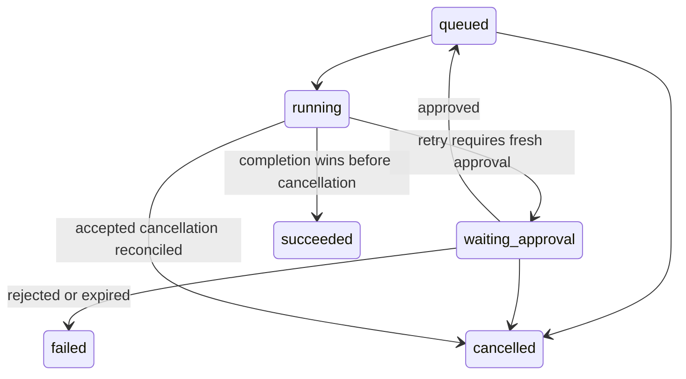

# Stage 2: local workflow controls

This extends the durable Harness fixture workflow. The SQL sandbox, offline CLI,
benchmark recordings and synthetic effect sink retain their identities. No live
provider is constructed. A workflow success still does not establish model quality.

## Contract and limits

| Mechanism | Behavior | Added complexity / limit |
|---|---|---|
| Identity | Explicit bearer token maps to a configured subject, tenant and approver permission; tenant headers/bodies grant no access | Local demo identities only: no OIDC, token expiry, revocation service or production authentication |
| Isolation | Every API job, attempt, result, trace, approval, operation and budget query uses authenticated tenant scope; list filters remain scoped | Application enforcement; database credentials are trusted operator authority, without PostgreSQL RLS |
| Trace privacy | API responses allowlist fields and replace raw traces with counts; prompts, SQL, rows and unknown fields are omitted | Original private database evidence remains sensitive; database operators can inspect it |
| Approval | Persisted, one use per attempt, bound to the resolved payload SHA-256 and immutable action version; 60-second expiry bounded by job deadline | Retry/recovery requires fresh approval; no automatic renewal or transferable approval token |
| Cancellation | Job row serializes cancellation against claiming, dispatch and completion | A running operation cannot be claimed physically stopped merely because cancellation was accepted |
| Budget | Quote reserved transactionally before dispatch, then settled from known usage; unknown pricing denies dispatch | Integer **synthetic credits**, not dollars; no live billing integration |

For `demo=effect` and `demo=provider`, approval is mandatory even when a request
sets `require_approval=false`. Other fixture jobs may request approval. An approver
permission comes only from credential configuration. The submitter and approver
are separate example identities; a trusted operator can configure one identity
with both permissions. This is not enforced organizational separation of duties.

Jobs have these added transitions:



`retry_wait` retains Stage 1 behavior for jobs without approval. Action, version,
tenant and approval policy are immutable. To change an action, submit a new job;
a conflicting reuse of the idempotency key returns 409. Identical keys in different
tenants identify separate jobs. Decisions cannot be replayed after approval,
rejection or consumption. An expired request cannot be approved or dispatched;
a worker reconciliation makes its terminal failure visible. The database records
request creation, authorized subject, decision time, consumption and attempt.

A queued/waiting/retry cancellation is immediately terminal. A running cancellation
returns 202 with `cancel_requested_at`; it blocks lease renewal and new dispatch.
The supervisor terminates its local process at its next heartbeat (normally within
five seconds plus bounded database/process handling). A worker crash or database
outage delays reconciliation until recovery. If completion holds the job lock and
commits first, cancellation returns 409. If cancellation commits first, the job
becomes cancelled even when a subsequent result proves the operation completed;
that result remains in the attempt and operation records.

The persisted `in_flight` write is the dispatch authorization boundary. It precedes
the local provider invocation, so a crash between the write and actual invocation
is conservatively uncertain. Cancellation after this boundary does not establish
remote preemption. The deterministic provider runs in the existing credential-free
bounded child process. The synthetic effect still uses its separate deduplicating
SQLite sink. No exactly-once external-effect guarantee is made.

Provider quote = 10 credits; known actual usage = 6. Concurrent reservations update
one tenant budget row with an available-balance predicate. A missing budget or
price denies the provider call. A committed reservation with no dispatch can be
released on recovery; an in-flight call with no known usage becomes `uncertain`
and keeps its reservation. Unknown usage remains held even if the job succeeds.
A later authenticated attempt result may settle known billing after lease loss or
cancellation, but cannot commit a job result. Repeated settlement cannot charge
twice. Actual usage above a quote is recorded honestly and blocks later spending
when no credit remains; the fake provider itself never exceeds its quote.

## Local setup and demonstration

Use Python 3.12 and the locked workflow environment. Native workers and the full
integration suite require Linux; Windows/macOS use Docker Linux. Keep the API on
loopback. Do not publish this demonstration as a production authenticated service.

```bash
uv sync --locked --extra workflow
uv run --no-sync arh data
python scripts/configure_workflow.py
docker compose --env-file .env.workflow -f compose.workflow.yaml -p arh-stage2-demo build
docker compose --env-file .env.workflow -f compose.workflow.yaml -p arh-stage2-demo up -d --wait
# Operator-only funding: these credits cannot purchase any real provider usage.
docker compose --env-file .env.workflow -f compose.workflow.yaml -p arh-stage2-demo run --rm migrate arh jobs set-budget --tenant tenant-a --limit-units 20
python scripts/workflow_controls_client.py submit --key interview-stage2 --demo provider
python scripts/workflow_controls_client.py --subject approver-a approvals
```

Inspect `proposed_action`, `action_hash`, version and attempt number in the approval
response. Use its actual ID and SHA-256 below; do not approve an unexamined action.

```bash
python scripts/workflow_controls_client.py --subject approver-a decide APPROVAL_UUID --decision approved --action-hash ACTION_SHA256 --action-version 1
python scripts/workflow_controls_client.py get JOB_UUID
python scripts/workflow_controls_client.py operations JOB_UUID
python scripts/workflow_controls_client.py budget
python scripts/workflow_controls_client.py --subject approver-b get JOB_UUID
# Expected: 404 for tenant B, despite knowledge of the identifier.
python scripts/workflow_controls_client.py submit --key cancel-example --demo provider
python scripts/workflow_controls_client.py cancel JOB_UUID
```

The client reads ignored `.local/workflow-auth.json`; it never prints tokens,
uses proxies or follows redirects. Configuration stores API-only demo credentials
in ignored `.env.workflow`; Docker administrators can inspect a container's
environment. Workers/executors receive no API token or auth file. Requested mode
0600 is not proof of Windows ACL protection. Never capture full environments,
`docker inspect` environment arrays, credential files or Compose-expanded secrets
in evidence. `/live` and `/ready` expose fixed health status without authentication.

Native API startup requires `ARH_WORKFLOW_DATABASE_URL` and either
`ARH_WORKFLOW_AUTH_FILE` or `ARH_WORKFLOW_AUTH_JSON`; absent credentials fail closed.
`arh jobs submit/list/get/attempts` are trusted **database operator** commands and
now require `--tenant`. They are not an alternate tenant-authenticated client.

For an existing Stage 1 installation, stop its API/workers, retain the volume and
credential file, and run `python scripts/configure_workflow.py --auth-only` from
that installation directory. This preserves the database password and adds local
identity. The normal migration service applies checksummed `002_controls.sql`;
`001_initial.sql` is unchanged. Pending old effect jobs acquire approval gates.
Old payloads whose source/provenance no longer match fail closed when executed;
terminal records remain intact. Rollback of code against the newer schema is
unsupported: retain a backup and use a compatible revision. Do not run the
historical Stage 1 verifier against this Stage 2 API; its recorded evidence remains
valid only for its recorded Stage 1 revision.

## Verification and evidence

```bash
uv run --no-sync python scripts/verify_workflow_controls.py --output .local/stage2/run-001
# Full real PostgreSQL tests in the bounded isolated Compose test database:
docker compose --env-file .env.workflow -f compose.workflow.yaml -p arh-stage2-demo run --rm checks
```

The verifier writes exact commands, revision, dirty state, source hashes,
environment, exit codes, logs and JUnit output. A missing dedicated
`ARH_WORKFLOW_TEST_DATABASE_URL` yields **PARTIALLY VERIFIED** and exit 2, even when
the local checks pass. No failed receipt is overwritten. With a dedicated database,
tests retain unique schemas and failed rows rather than deleting evidence.

The PostgreSQL suite includes identifier/list/search tenant attacks; role checks;
approval rejection, expiry, changed hash/version and replay; fresh approvals after
crash/retry; completion/cancellation races; shared-budget contention; release of
known-undispatched reservations; uncertain cost retention; missing price/usage;
and real API and worker subprocess restarts with a deterministic fake provider.
A real PostgreSQL/Docker run is required before claiming these behaviors verified.
WASM PostgreSQL schema checks, when reported, establish schema execution only.
CI configuration is distinct from an actual CI run at this revision.

Stop only this owned demonstration, preserving persistent data:

```bash
docker compose --env-file .env.workflow -f compose.workflow.yaml -p arh-stage2-demo down
```

## Learning and ownership

This Stage 2 change is AI-assisted; it establishes no independent personal
contribution or production usage. Explain the dispatch/crash window, lock ordering
(job, operation/approval, budget), one-use approval policy, and why cancellation
cannot prove remote preemption. As a bounded independent exercise, implement a
human-reviewed reconciliation command for uncertain fake-provider costs. Require
operator authorization, immutable decision history, idempotent settlement and
cross-tenant rejection tests; do not discard unknown reservations automatically.
