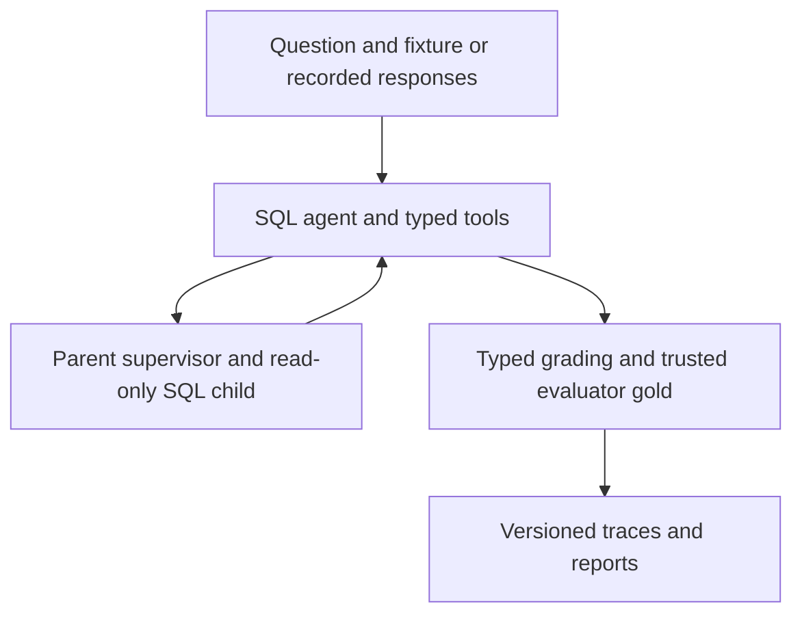
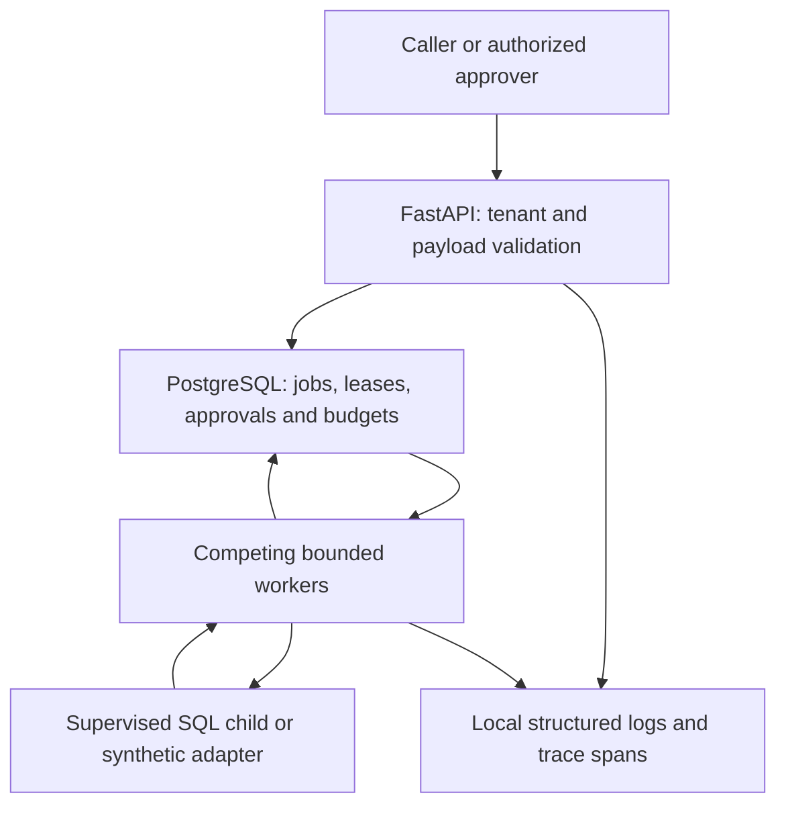
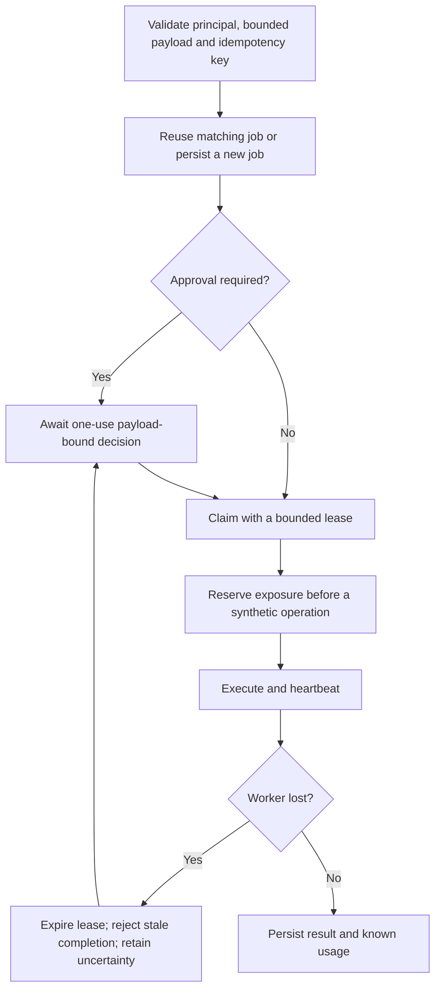

# Architecture and decisions

This describes the prepared local branch. [Evidence and exact identities](EVIDENCE.md)
distinguish it from public main and historical releases.

## SQL evaluation boundary

Gold belongs to the evaluator, not the provider request. Final answers must
reference complete results from their own attempt. Exact replay reads saved
traces; regression executes current tools and rejects incompatible recordings.
[Core threat boundary](../THREAT_MODEL.md), [SQL runtime](../../src/agent_reliability/sandbox/runtime.py).

## Durable local execution

The PostgreSQL credentials stay with trusted services. Agent-accessible SQLite
is separate. Persisted trace/parent IDs connect HTTP admission to a worker span;
metrics require authentication and aggregate only the caller's tenant.

## Admission and recovery flow

The recovery arrow represents approval-protected synthetic actions used in the
restart test. Ordinary SQL jobs follow their configured retry policy; they do not
all require approval. A successful job does not establish a correct SQL answer.
Logical effect deduplication is an adapter property, not universal exactly-once delivery.

## Choices and alternatives

| Choice | Alternative and trade-off |
| --- | --- |
| PostgreSQL leases and durable state | An in-process queue is simpler but loses recovery state across process death. A separate broker adds operations and would need a demonstrated workload. |
| Payload-bound one-use approvals | A reusable broad permission is easier to operate but does not bind this action/version/attempt. |
| Unknown exposure remains held | Automatically refunding on timeout could authorize spending already incurred. Reconciliation is still human/future work. |
| Separate runtime and checks images | One image is simpler; Git is required for provenance tests but is unnecessary application tooling. Both images bind the same selected inputs. |
| Coordinated stop-and-copy backup | Online backup avoids downtime but must coordinate PostgreSQL and the separate effect/report volume. Current scope favors a verifiable boundary. |
| Refuse incompatible rollback | Automatic down migrations can destroy or misinterpret state. Matching-image restart is supported; a real downgrade needs a matching pre-upgrade snapshot. |
| Local JSON span export | A hosted collector adds credentials and external data flow. Current evidence proves representative API-to-worker causality, not a hosted tracing service. |

[Earlier design decisions](../DECISIONS.md) remain intact. [Failure case study](CASE_STUDY.md)
and [threat model](THREATS.md) explain the operational limits.
